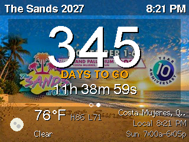
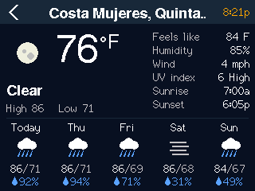
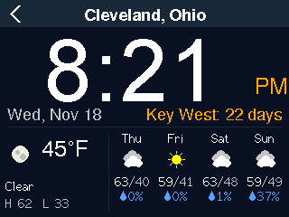
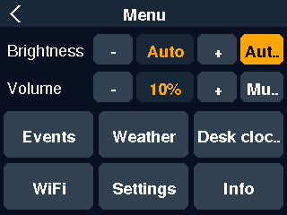
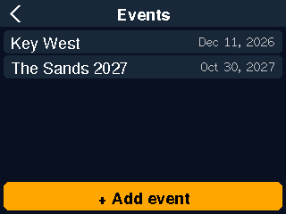
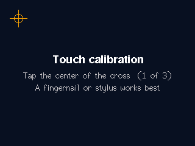

# Countdown Clock

A countdown clock for vacations, birthdays, concerts, or anything else worth counting down to, built on the ESP32-2432S028R ("Cheap Yellow Display", 2.8" 320×240 touch screen). It shows days, hours, minutes and seconds over your own photo, with live weather and local time at the event's location.

Created by **jhollin1138**.

## Features

- **Up to 6 events**, kept in date order: shows the next one, or rotates between them. Swipe to switch.
- **Location weather** from [Open-Meteo](https://open-meteo.com) (free, no API key): current conditions, a detail screen with feels-like, humidity, wind, UV, sunrise/sunset, and a 5-day forecast with chance of rain
- **Local time at the location** (DST-aware)
- **Desk clock mode**: tap the time in the top-right corner for a large clock with your home weather, a 4-day forecast with chance of rain, and a countdown line for your next event. It stays on until you tap the back arrow or the clock face, even after a restart. It also appears automatically when there are no upcoming events (you can turn that off).
- **Photo backgrounds** per event. Photos are cropped to 320×240 in your browser before upload. Each event has a **shading preset** (None, Light, Medium, Dark) for the panels behind the text.
- **Milestone sounds and LED show** at 100, 60, 30, 14, 7, 3, 2, 1 and 0 days, plus a celebration when the countdown hits zero
- **Custom sounds**: MP3 or WAV clips, RTTTL ringtones, or three built-in tunes, with **volume control**
- **Auto-brightness** from the onboard light sensor, and **quiet hours** that dim the screen and silence sounds overnight
- **Touch interface**: menu, event editor with on-screen keyboard and date picker, WiFi setup, settings
- **Settings web page** at `http://countdown.local`
- **Wireless firmware updates**, **settings backup/restore**, and **screenshots** of the clock's screen, all from the web page

## Screens

| Countdown | Location weather | Desk clock | Settings |
|:---:|:---:|:---:|:---:|
|  |  |  |  |

**Setup on the clock: no computer needed**

| Add an event | WiFi setup | Touch calibration | Calibration test |
|:---:|:---:|:---:|:---:|
|  |  |  |  |

## Hardware

| Part | Notes |
|---|---|
| ESP32-2432S028R | The common single micro-USB version uses the `cyd` build. The two-USB version (micro-USB + USB-C) uses `cyd2usb`. |
| 8 Ω speaker, 0.5–1 W | Plugs into the 2-pin 1.25 mm **SPEAK** connector |
| microSD card (optional) | FAT32. Holds photos and sounds if you want more than internal flash allows. |
| 5 V supply | USB, or 5 V into **VIN/GND** on the 4-pin 1.25 mm power connector (for example a USB-C conveter, breakout, or a PD trigger board **set to 5 V**) |

**Case design notes**
- The **light sensor** is on the front beside the screen. Leave a 3–4 mm hole or light pipe over it.
- **Block the backlight bleed next to the light sensor.** The display leaks a lot of light right beside the sensor, so it always reads "bright" and auto-brightness never dims. Cover the bleed area with a small piece of black electrical tape, and/or add a printed shield around the sensor. To check: on the settings page, the live sensor reading should rise clearly when you cover the sensor with something opaque or turn off the room lights. A fingertip isn't a good test, because red light passes through skin.
- The **RGB LED** is on the back. Add a window or light pipe if you want the milestone light show visible.
- Leave openings for the speaker and, if used, the SD card slot.
- With wireless updates, the USB ports can be hidden inside the case.

### 3D-printed enclosure

A matching enclosure is on MakerWorld: **[CYD Countdown Clock](https://makerworld.com/en/models/3671305-cyd-countdown-clock-esp32-touchscreen-with-weather#profileId-4214932)**. It's compact (about 105 × 50 × 62 mm), tilts the screen to 55°, prints without supports, and has a tool-free USB-C breakout mount, a speaker grille with bracket, a light shield for the sensor, and a pocket for a Nintendo DS-style stylus.

- Hardware: 4 × M3×16 mm socket head cap screws (case), 2 × M3×6 mm button head screws (speaker bracket)
- Two-color print, with profiles for the A1 mini (two plates) and larger printers (one plate, print by object)
- Power: a USB-C conveter board wired to the CYD's VIN and GND. Check for +5 V on the VIN wire before connecting the board.

## Installing

### Option A: build it yourself
1. Install [VS Code](https://code.visualstudio.com) and the **PlatformIO IDE** extension.
2. Open this folder (File → Open Folder) and wait for PlatformIO to finish setting up.
3. Plug in the board and click **→ Upload** in the blue status bar. For the two-USB board, pick the `cyd2usb` environment first. If the upload won't connect, hold **BOOT** as it starts.

### Option B: use a release file
From the latest [release](../../releases/latest), download the `-full.bin` file for your board, for example `countdown-clock-cyd-v1.3.0-full.bin` (or `countdown-clock-cyd2usb-v1.3.0-full.bin` for the two-USB board). Flash it at address **0x0** with the [Espressif web flasher](https://espressif.github.io/esptool-js/) in Chrome or Edge.

### First start
1. **Touch calibration**: tap the three crosses (a fingernail works best), then tap around to check the dots land under your finger.
2. **WiFi**: tap **Set up on this screen**, or join the **Countdown-Setup** WiFi from a phone or laptop and browse to `http://192.168.4.1`. Only 2.4 GHz networks work.
3. Open `http://countdown.local` (or the IP shown on screen) and add an event. To use desk clock mode, also set your **home location** there or under Menu → Settings → Home location.

### Updating
Build in VS Code with **✓ Build**. Besides the usual `.pio/build/cyd/firmware.bin`, the build saves a copy with the version in its name to the project's `firmware` folder, for example `firmware/countdown-clock-cyd-v1.3.0.bin`. On the settings page, go to **Firmware update** and choose that file (or the matching file from a release, for example `countdown-clock-cyd-v1.3.0.bin`; the `-full.bin` files are only for USB installs). Settings, photos and sounds are kept.

> **Upgrading from 1.0/1.1:** version 1.2 changes the flash layout, so the first install of 1.2 must be over USB, and it erases events, settings and photos stored in internal flash (WiFi is kept). Before flashing, save `http://countdown.local/api/config` as a file. Afterwards, re-upload your photos, then use **Restore from a backup file**.

## Using the clock

| Gesture | Action |
|---|---|
| Swipe left / right | Next / previous event |
| Tap the middle | Next event |
| Tap the weather bar | Weather detail and 5-day forecast |
| Tap the time (top right) | Desk clock mode: large clock with home weather and your next event. It stays on, even after a restart, until you tap the back arrow or the clock face. |
| Hold 1 s | Menu: brightness, volume, mute, Events, Weather, Desk clock, WiFi, Settings, Info |
| Hold 8 s | Re-run touch calibration |
| Tap a celebration | Dismiss it and stop the sound |

## Sounds

- **Built-in**: Chime, Fanfare, Island bells.
- **RTTTL ringtones**: paste a line like `Tune:d=4,o=5,b=120:c,e,g,2c6` into **Add ringtone** on the settings page. [RTTTL Hub](https://rtttl-hub.io/collections/esphome) has a large collection ready to copy.
- **MP3 / WAV**: upload short clips (under 30 s works best; playback stops after 90 s). The speaker output is 8-bit, so mono 22 kHz MP3s at 64 kbps sound the same as larger files and save space.
- Volume is on the settings page and in the on-screen menu. If even low settings are too loud for your speaker, a 10–22 Ω resistor in series with it helps.

## Storage

| | Internal flash | microSD |
|---|---|---|
| Space | about 500 KB shared by photos and sounds | as big as the card |
| Folder | — | `/countdown/` for photos, `/countdown/sounds/` for sounds |

A 320×240 photo is about 25–35 KB. You can copy baseline (not progressive) JPEGs and MP3/WAV/`.rtttl` files straight onto the SD card from a computer.

## Weather

Weather for every event location and your home location is fetched in a single request a few seconds after the clock connects, then refreshed every 15 minutes (the rate at which Open-Meteo updates current conditions). If a request fails, it retries after 2 minutes.

## Screenshots

To capture the clock's screen, go to the screen you want on the clock, then click **Take screenshot** on the settings page and **Download PNG**. The picture is read straight from the display, so it's pixel-exact with no glare. It works on the standard single-USB CYD. Some two-USB boards can't read back from their display.

## Troubleshooting

- **Colors look negative**: tick *Invert colors* on the settings page.
- **Picture garbled on a two-USB board**: flash the `cyd2usb` build. If red and blue are swapped, add `-DTFT_RGB_ORDER=TFT_BGR` to its build flags.
- **Taps land in the wrong spot**: hold anywhere for 8 seconds, or Menu → Settings → Calibrate touch.
- **Auto-brightness stuck at full or the sensor always reads 0**: the backlight is probably bleeding into the sensor. See the case design notes above.
- **Auto-brightness backwards or not changing enough**: use the two *Use as…* buttons on the settings page in a bright and a dark room, then save.
- **`countdown.local` doesn't open** (some Android phones): use the IP address from Menu → Info.
- **Change WiFi**: Menu → WiFi on the clock, or *Reset WiFi* on the settings page.

## Code layout

| File | Purpose |
|---|---|
| `src/main.cpp` | Startup, WiFi, mDNS, NTP |
| `src/display.cpp` | Main countdown screen, event selection, milestones |
| `src/ui.cpp` | Touch screens: menu, weather, home clock, keyboard, WiFi, events, settings, calibration |
| `src/audio.cpp` | Sound playback through the built-in DAC (GPIO26 only; GPIO25 is the touch clock): RTTTL and WAV players, MP3 via minimp3 |
| `lib/minimp3` | Public-domain MP3 decoder |
| `src/weather.cpp` | Open-Meteo weather and place search |
| `src/web.cpp`, `src/webpage.h` | Settings web server and page |
| `src/hw.cpp` | Backlight, light sensor, touch and gestures, RGB LED |
| `src/config.cpp` | Settings storage and photo library |
| `partitions.csv` | Flash layout with two app slots for wireless updates |
| `scripts/versioned_bin.py` | Build step that saves `firmware/countdown-clock-<board>-v<version>.bin` |

## Credits

Built with [TFT_eSPI](https://github.com/Bodmer/TFT_eSPI), [TJpg_Decoder](https://github.com/Bodmer/TJpg_Decoder), [WiFiManager](https://github.com/tzapu/WiFiManager), [ArduinoJson](https://arduinojson.org) and [minimp3](https://github.com/lieff/minimp3), with weather and geocoding from [Open-Meteo](https://open-meteo.com). See `THIRD_PARTY_NOTICES.md` for their licenses.

## License

Copyright 2026 jhollin1138. Licensed under the [PolyForm Noncommercial License 1.0.0](LICENSE.md).

You're welcome to build, use, modify and share this project for **personal, hobby, educational and other noncommercial purposes**. **Commercial use is not permitted**, including selling the firmware, selling assembled clocks, or bundling it with products for sale. For commercial licensing, contact jhollin1138.

The 3D-printable enclosure is published separately on MakerWorld under its own license.
